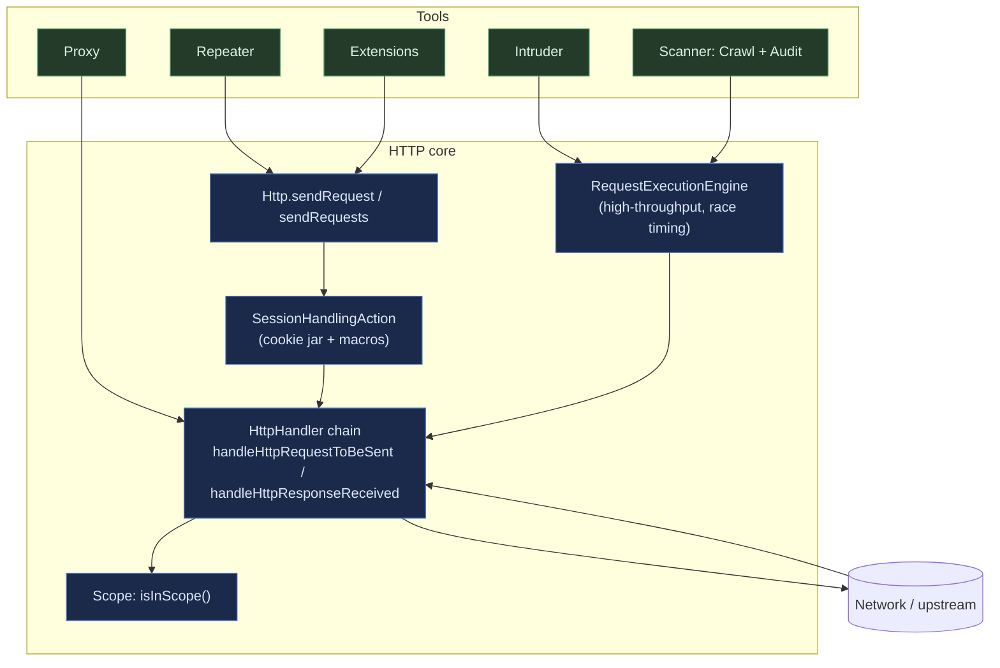
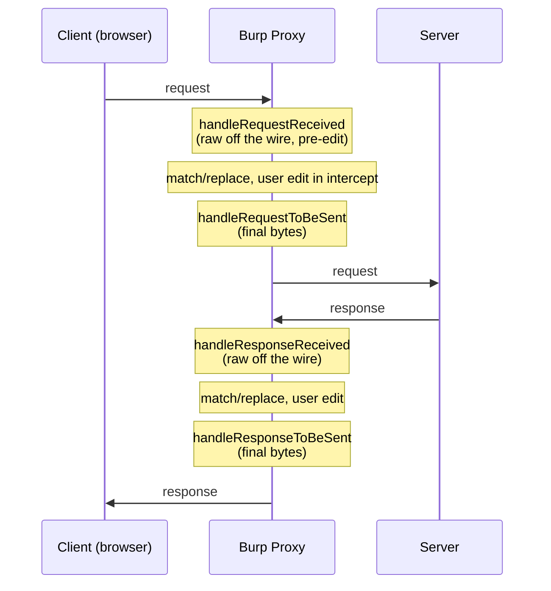
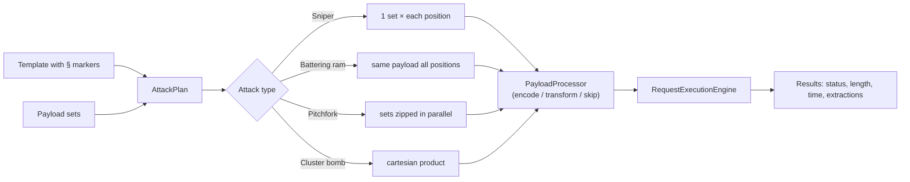
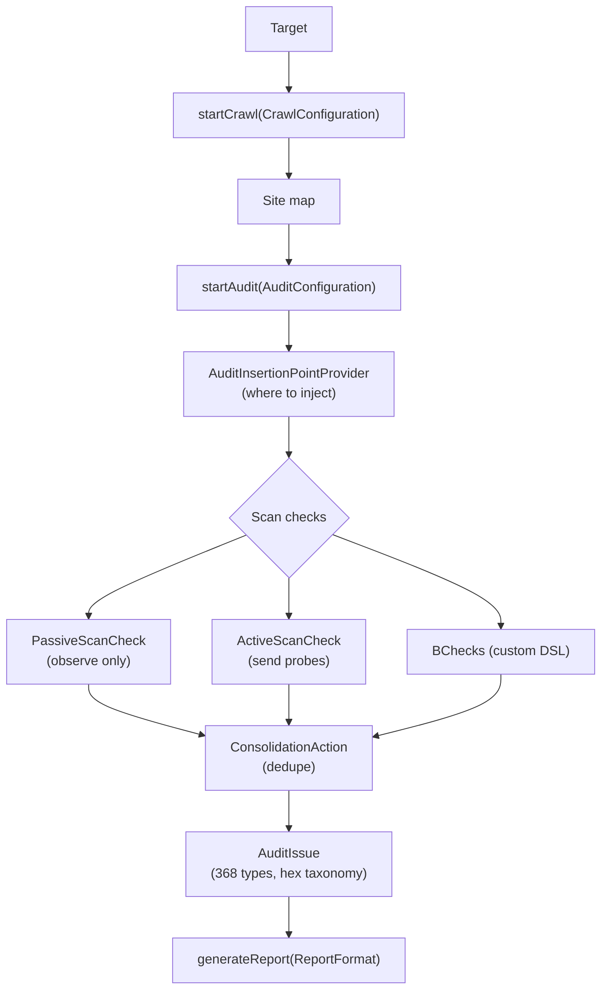
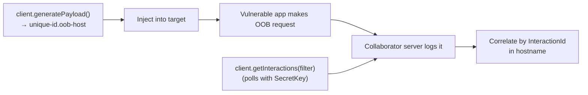
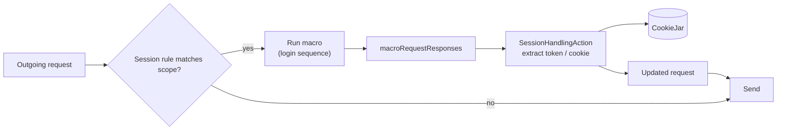

# Burp Suite architecture — reverse-engineered, mapped to ferrite

Reference for building ferrite features. Target: Burp Suite 2026.9.1 (build 54592).
Everything here comes from the un-obfuscated Montoya API (`burp.api.montoya.*`), the
plaintext `resources/`, and public behaviour. The engine classes are obfuscated with
Zelix KlassMaster (names mangled, string literals encrypted at runtime), so the exact
algorithms are not statically recoverable — the *data flow* and *contracts* below are,
and they are what ferrite needs.

## Legal line

Burp's 368 issue-definition texts and its bundled `.pay` payload files are PortSwigger
copyrighted content. They are **not** copied into ferrite. ferrite mirrors structure
and taxonomy (facts) and ships its own freshly written payloads and issue text.

## Top-level: one HTTP core, one handler pipeline

Every Burp tool (Proxy, Repeater, Intruder, Scanner, extensions) shares a single HTTP
engine and a single handler chain. Tools do not each own a socket stack; they submit
requests to the core and register handlers to observe/modify all traffic.

Key facts:
- `Http.createRequestEngine()` returns a `RequestExecutionEngine` — the shared
  high-throughput sender Intruder and Scanner use. This is also where race/timing
  control lives (last-byte sync, HTTP/2 single-packet multiplexing).
- One `HttpHandler` sees *all* tool traffic, not just the proxy. Session handling and
  match/replace run here, so they apply everywhere.
- **ferrite:** `src/session.rs` (`Client`, `send_probe`, `send_protocol`) is the HTTP
  core; `src/http.rs` is the message model. There is no single shared handler chain —
  each tool calls the client directly. Adding a shared pre-send hook (session rules,
  match/replace) would mirror Burp's `HttpHandler`.

## Proxy / MITM

**What it does:** intercepts, logs, and lets you edit live traffic; generates a CA to
MITM TLS.

**How it works — 4-phase interception** (`proxy.http`), two stages per direction:

- The received-vs-toBeSent split lets a handler see traffic *before* Burp's own
  modifications separately from the final bytes. WebSockets have the mirror set
  (text + binary, plus a creation handler).
- MITM CA is generated per install at first run and stored in config — **not** bundled
  (`resources/Crypto/ps.p12` is password-locked and is PortSwigger's own signing cert,
  not the CA). `ssl_pass_through` lists hosts that bypass MITM entirely.
- Config: `intercept_client_requests`, `intercept_server_responses`,
  `intercept_web_sockets_messages`, `match_replace_rules` (+ out-of-scope disable),
  `request_listeners`, `response_modification`.
- **ferrite:** `src/proxy.rs` + `src/intercept.rs` (hudsucker). hudsucker gives one
  request + one response hook — the single "toBeSent" stage. If ferrite wants
  match/replace observability distinct from user edits, split each hook into
  received/to-be-sent.

## Repeater

**What it does:** resend and iterate on a single request by hand.

**How it works:** thin UI over the HTTP core; the interesting part is transport options.
Burp exposes: `allow_http2_alpn_override`, `enable_http1_keep_alive`,
`enable_http2_connection_reuse`, `enforce_protocol_in_redirections`,
`process_cookies_in_redirections`, `strip_connection_header_over_http2`,
`normalize_line_endings`, `unpack_gzip_deflate`, `update_content_length`,
`streaming_response_timeout_millis`.

- **ferrite:** `src/repeater.rs` + `src/ws_repeater.rs`. Already has `http2`,
  `update_length`, `use_cookies`, follow-redirection. Missing the h2 edge toggles
  (`strip_connection_header_over_http2`, `allow_http2_alpn_override`) and
  `normalize_line_endings`. These are the cheapest Burp-parity additions.

## Intruder

**What it does:** automated request fuzzing over marked insertion points.

**How it works:**

- The Montoya API is generator-centric: `PayloadGenerator` / `PayloadGeneratorProvider`,
  `PayloadProcessor` (`PayloadProcessingAction`: SKIP_PAYLOAD/…), `IntruderInsertionPoint`.
  The four attack types are a UI concept layered on top.
- **ferrite:** `src/intruder.rs` already implements all four + Null, `§` markers,
  payload processing, URL-encoding, number ranges. Now also ships built-in payload
  presets (`assets/payloads/*.pay`, bundled via `include_str!`). This is at parity.

## Scanner — Crawl + Audit

**What it does:** discover content (crawl), then test it for vulnerabilities (audit),
producing deduplicated issues.

**How it works:** two separable phases plus a pluggable check model.

- Issue taxonomy: `resources/KnowledgeBase/Issues/*.json`, keyed by hex `typeIndex`.
  Families: `0010` injection, `0020` client-side/request (XSS, smuggling, desync, cache
  poisoning, prototype pollution), `0050`, `0040`, `0060`, etc. Each entry = name,
  description, remediation, typicalSeverity, references, vulnerabilityClassifications.
- Built-in scan presets: `resources/BuiltInConfigs/` (Crawl+Audit Fast/Balanced/Deep/
  Lightweight/CICD, coverage thorough/maximum, minimize false pos/neg, passive-only…).
- **ferrite:** `src/scanner.rs` (passive + active `Check`), `src/crawler.rs`,
  `src/deep_scan.rs` (differential probes), `src/discovery.rs`. Check-driven, ~20 issue
  titles vs Burp's 368. Gaps: breadth of checks, named scan presets, consolidation
  policy. Issue *prose* must be ferrite-original.

## Collaborator / out-of-band

**What it does:** detect blind/OOB vulnerabilities via a server that records DNS/HTTP/SMTP
hits to unique hostnames.

**How it works:**

- A client is just a `SecretKey`: `createClient()` / `restoreClient(SecretKey)`, so
  polling survives restarts. Interaction types **DNS / HTTP / SMTP** with typed details
  (`DnsDetails` + 16 `DnsQueryType`: A, AAAA, CNAME, TXT, MX, NS, SOA, SRV, …;
  `SmtpDetails` + `SmtpProtocol` SMTP/SMTPS; `HttpDetails`). Correlation is the
  `InteractionId` embedded in the payload hostname.
- **ferrite:** `src/interactsh.rs` + `src/callbacks.rs` already do OOB via Interactsh.
  Parity gaps: a `SecretKey`-style restore token and capturing the DNS query *type*.

## Session handling + macros

**What it does:** keep automated tools authenticated — re-login, refresh CSRF tokens,
set cookies — by running a macro (saved request sequence) before/around each request.

**How it works:** `SessionHandlingAction.performAction(data)` receives
`SessionHandlingActionData`, which carries the current `request`, the
`macroRequestResponses()` (the macro that just ran), and `Annotations`. The action
returns a modified request. A shared `CookieJar` (`setCookie`, `cookies()`) persists
state across tools.

- **ferrite:** `src/session.rs`, `src/macros.rs`, `src/browser_auth.rs`. Macro capture
  exists; a scoped session-handling-rule engine that rewrites requests pre-send (hung
  off the shared send hook above) is the structural piece to mirror.

## Scope

Simple predicate shared by all tools: `isInScope(url)`, `includeInScope`,
`excludeFromScope`, plus a change handler. Everything (proxy logging, scanner,
match/replace) gates on it. **ferrite:** `src/target.rs`.

## Extensions

Legacy `IBurpExtenderCallbacks` and modern `BurpExtension` + `MontoyaApi`. Extensions
register handlers (`HttpHandler`, `ScanCheck`, `SessionHandlingAction`,
`PayloadGenerator`, context-menu/editor UI) against the core. **ferrite:**
`src/extensions.rs` + the Python SDK (`sdk/ferrite_sdk.py`).

## What needs dynamic analysis

Static RE stops at the contracts above. The actual algorithms — crawl heuristics,
audit insertion-point mutation, HTTP/2 multiplexing and race timing, CA minting — are
Zelix-encrypted. To recover those, run Burp under its bundled JRE and hook the JVM with
Frida (REA `start_frida_session` / `instrument_with_frida`) against one feature at a
time. Not done here; say which feature and it can be traced live.
